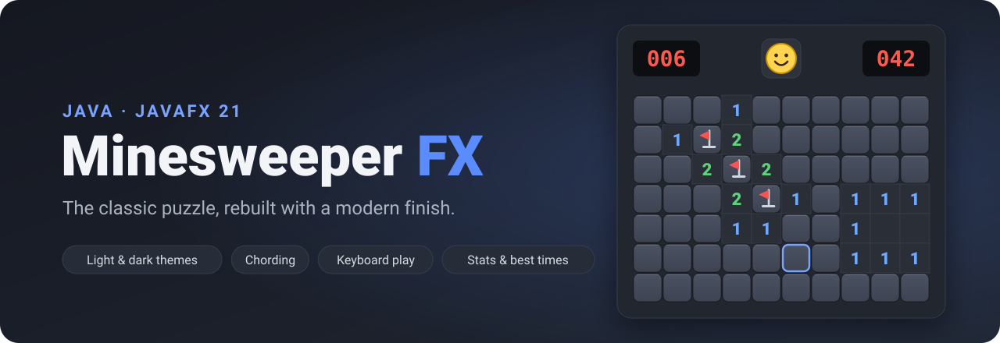

<p align="center">
  
</p>

<p align="center">
  <a href="https://github.com/chourouk5885/minesweeper-fx/actions/workflows/ci.yml"></a>
  
  
  <a href="LICENSE"></a>
  
</p>

<p align="center">
  <b>Minesweeper the way you remember it — with smooth animations, a dark mode, full keyboard play and a leaderboard.</b><br>
  Written in pure Java with JavaFX. One command to play.
</p>

---

## Play in 30 seconds

You need **Java 17+** and **Maven**.

```bash
git clone https://github.com/chourouk5885/minesweeper-fx.git
cd minesweeper-fx
mvn javafx:run
```

That's it. Maven downloads JavaFX for your system (Apple Silicon, Intel, Windows or Linux) automatically.

> **New to Java?** On a Mac: `brew install openjdk@21 maven`. On Windows: install [Temurin JDK](https://adoptium.net) and [Maven](https://maven.apache.org/download.cgi).

##  Why you'll like it

** Fair from the first click.** Your first click is always safe and always opens an area. No more losing on move one.

** Light and dark themes.** Switch instantly from the Options menu. Every colour is tuned for contrast in both.

** It feels alive.** Squares press down under your cursor, empty areas open in a quick ripple, and a loss shakes the board before the mines cascade out from the one you hit. Win, and you get confetti.

** Chording for speed players.** When a number has all its mines flagged, click it (or middle-click, or press both buttons) to open every neighbour at once.

** Play without a mouse.** Arrow keys, Space to reveal, F to flag, C to chord.

** Stats and a leaderboard.** Win rate, streaks and your top 5 times for each difficulty, saved between sessions.

** Any board you like.** Beginner, Intermediate and Expert presets, or a custom board up to 50 × 30. Big boards shrink to fit your screen.

** Optional sound.** Little synthesized blips and booms, off until you turn them on.

##  Controls

| Action | Mouse | Keyboard |
|---|---|---|
| Reveal a square | Left-click | `Space` / `Enter` |
| Flag → ? → clear | Right-click | `F` |
| Chord (open the neighbours of a satisfied number) | Left-click the number · middle-click · left + right | `C` |
| Move the highlight | — | Arrow keys |
| New game | Click the face | `F2` or `N` |
| Help | — | `F1` |

On a Mac keyboard, the F-keys may need `fn` (e.g. `fn` + `F2`). `N` always works.

##  Difficulty levels

| Level | Board | Mines |
|---|---|---|
| Beginner | 9 × 9 | 10 |
| Intermediate | 16 × 16 | 40 |
| Expert | 30 × 16 | 99 |
| Custom | 5–50 × 5–30 | up to (cells − 9) |

##  Under the hood

```
minesweeper-fx/
├── src/main/java/com/minesweeper/
│   ├── App.java · Launcher.java      entry points
│   ├── model/                        game rules — no UI code, fully unit-tested
│   │   ├── Board.java                mine placement, flood fill, chording, win/loss
│   │   └── Cell · GameConfig · GameStats · Difficulty · …
│   ├── view/                         JavaFX UI
│   │   ├── BoardView · CellView      canvas renderer and animations
│   │   ├── HeaderBar · FaceIcon      counters and the status face
│   │   ├── GameMenuBar · Dialogs     menus, stats, best times, custom game
│   │   └── Theme.java                every colour for both themes
│   ├── controller/GameController     input, timer, game flow
│   └── util/                         settings, statistics storage, sound
├── src/main/resources/…/styles.css
└── src/test/java/…                   JUnit 5 tests
```

- **Model–View–Controller.** The rules engine knows nothing about JavaFX, so it is tested without a screen.
- **One canvas, not 1,500 buttons.** The board is drawn on a single `Canvas`, so even a 50 × 30 board stays smooth. Everything is vector-drawn and sharp at any size.
- **Safe first click by design.** Mines are placed only after your first click, away from it.
- **No stack overflows.** Flood fill is an iterative breadth-first search, which also drives the ripple animation.
- **Your data stays local.** Settings and stats live in `~/.minesweeper-fx/`.

##  Run the tests

```bash
mvn test
```

The tests cover first-click safety, adjacent-mine counts, flood fill, chording, win and loss detection, statistics and saving. They also run automatically on GitHub for every push.

##  Run from an IDE

Open the folder as a **Maven project** in IntelliJ IDEA, Eclipse or VS Code and run **`com.minesweeper.Launcher`**.
Use `Launcher` rather than `App`; starting a JavaFX `Application` directly from the classpath fails with *"JavaFX runtime components are missing"*.

##  Contributing

Ideas, bug reports and pull requests are welcome. See [CONTRIBUTING.md](CONTRIBUTING.md).

## 📄 License

[MIT](LICENSE) — free to use, modify and share.

<p align="center">If you enjoyed it, a ⭐ on the repo is the best way to say thanks.</p>
